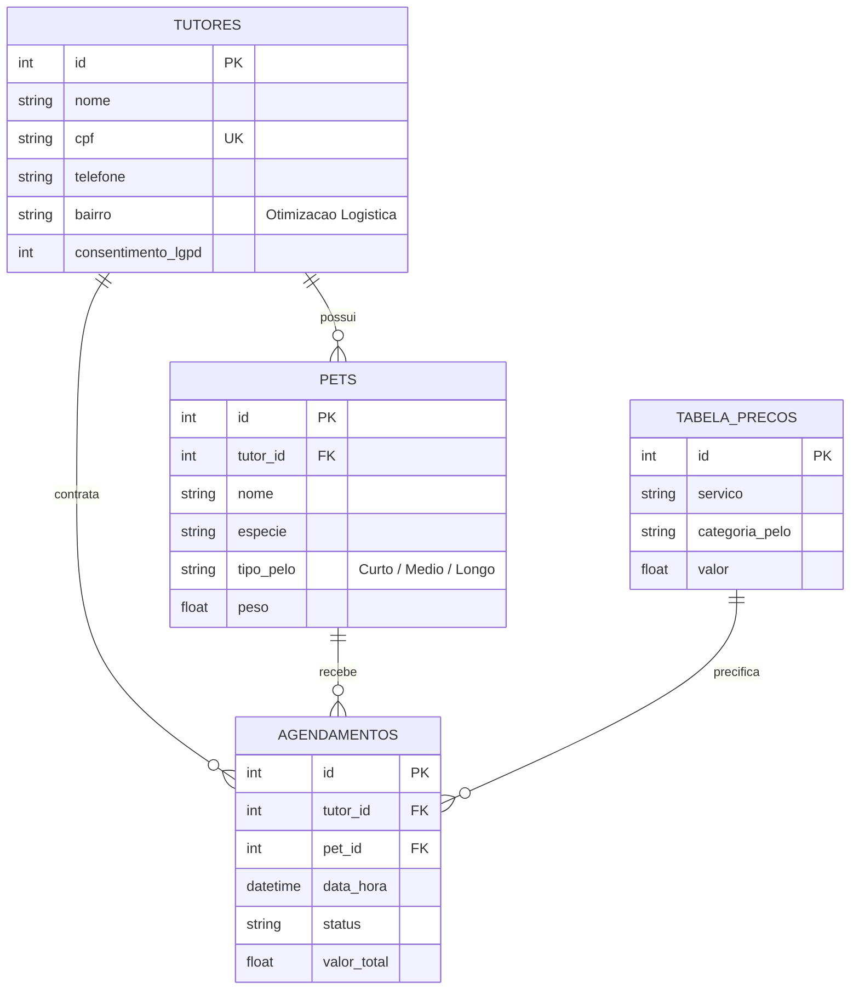

# 🐾 PetFlow: Sistema de Gestão para Clínicas & Pet Shops

<p align="left">
  
  
  
  
  <a href="https://github.com/jeronimo-jrsilva"></a>
  
</p>

---

### 📌 1. Visão Geral & Problema de Negócio

O **PetFlow** é uma solução completa desenvolvida para solucionar gargalos logísticos e operacionais em clínicas veterinárias e pet shops com serviço móvel de atendimento a domicílio (*Pet Móvel*).

A aplicação gerencia o ciclo completo de atendimento: cadastro de tutores com consentimento expresso da **LGPD**, categorização zootécnica de animais por tipo de pelagem, precificação dinâmica e otimização de rotas de atendimento por bairro.

---

### 🏗️ 2. Arquitetura & Decisões Técnicas

O projeto foi construído seguindo rigorosa modelagem relacional (DER) e separação de camadas:



#### Destaques de Engenharia:
- **Conformidade com a LGPD:** Registro explícito de termos de consentimento no momento do cadastro do tutor, garantindo rastreabilidade jurídica no tratamento de dados pessoais.
- **Logística Geográfica:** Estrutura orientada a bairros para agrupar atendimentos do veículo móvel por zona geográfica, reduzindo custos de deslocamento.
- **Precificação por Características Zootécnicas:** Integração automática entre tamanho/tipo de pelo e tabela de valores de procedimentos (banho, tosa, hidratação).

---

### 🛠️ 3. Tecnologias & Dependências

| Módulo | Tecnologia | Propósito |
| :--- | :--- | :--- |
| **Backend & Engine** | Python 3.10+ | Scripting de banco, migrations e regras de validação |
| **Persistência** | SQLite3 Relacional | Banco estruturado com chaves estrangeiras e integridade referencial (`ON DELETE CASCADE`) |
| **Interface de Usuário** | HTML5 Semântico, CSS3 & JavaScript Puro | Painel responsivo de agendamento e visualização de atendimentos |
| **Governança** | Git Flow & Semantic Commits | Controle de versão com rastreamento no `CHANGELOG.md` |

---

### 🚀 4. Como Executar Localmente

#### Pré-requisitos:
- Python 3.8 ou superior instalado.
- Navegador web moderno.

#### Passo a passo:
```bash
# 1. Clone o repositório
git clone https://github.com/jeronimo-jrsilva/petflow-management-system.git

# 2. Acesse o diretório
cd petflow-management-system

# 3. Inicialize e popule o banco de dados SQLite
python3 src/database_setup.py

# 4. Abra o painel no navegador
# No Linux:
xdg-open index.html
# Ou simplesmente abra o arquivo index.html no navegador de sua preferência
```

---

### 📂 5. Estrutura de Diretórios

```text
petflow-management-system/
├── css/
│   └── style.css            # Estilização responsiva e tema visual
├── data/
│   └── petflow.db           # Banco de dados SQLite persistido
├── docs/
│   ├── Projeto_PetFlow_AV1.md  # Documentação de requisitos de negócio
│   └── Projeto_PetFlow_AV1.pdf # Relatório técnico formal
├── js/
│   └── app.js               # Lógica de interface e manipulação do DOM
├── src/
│   └── database_setup.py    # DDL e DML de inicialização do schema relacional
├── CHANGELOG.md             # Histórico de versões
├── index.html               # Ponto de entrada da interface web
└── README.md
```

---

### 👤 Autor & Contato

<p align="left">
  <strong>Jeronimo Silva</strong><br>
  <em>Estagiário em Desenvolvimento de Software | Graduando ADS (SENAC Ceará)</em><br>
  Fortaleza - CE | Disponível para Presencial, Híbrido e Remoto
</p>

<p align="left">
  <a href="mailto:jeronimo.aulas@gmail.com"></a>
  <a href="https://linkedin.com/in/jeronimojr-dev" target="_blank"></a>
  <a href="https://github.com/jeronimo-jrsilva"></a>
</p>
